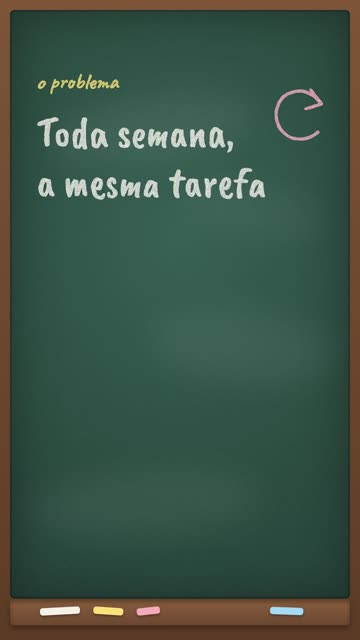
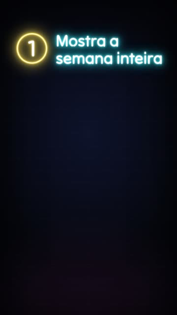
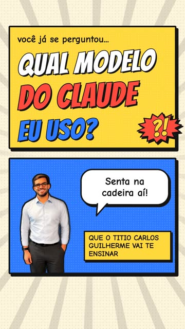
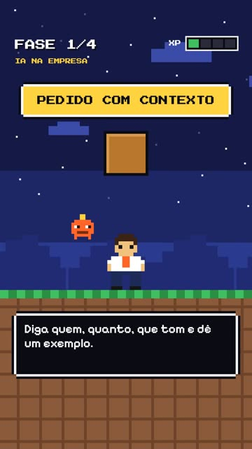
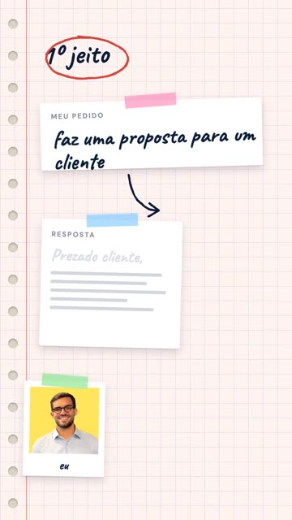

# Edições de vídeo para refazer com o Claude

Moldes de vídeo vertical (1080x1920) feitos em código com o [Remotion](https://www.remotion.dev). Cada estilo traz um vídeo de exemplo, o código completo e um passo a passo para você refazer com o seu roteiro e a sua voz, conversando com o Claude. Não gasta crédito de IA: o vídeo é código renderizado no seu computador.

Clique na miniatura para ver o exemplo.

| Prévia | Estilo |
|---|---|
| [](previas/papel-recortado.mp4) | **Papel recortado** (25 s)<br>Um mundo de papel para cada frase, carimbo de veredito e o apresentador como adesivo que balança com a voz.<br>[Passo a passo](moldes/papel-recortado.md) · `PapelRecortado` |
| [](previas/quadro-negro.mp4) | **Quadro-negro** (52 s)<br>Lousa verde, tudo escrito e desenhado a giz na hora da fala, apagador entre as cenas.<br>[Passo a passo](moldes/quadro-negro.md) · `QuadroNegro` |
| [](previas/neon.mp4) | **Desenho que brilha** (42 s)<br>Letreiros e desenhos de tubo de neon que acendem piscando na palavra certa.<br>[Passo a passo](moldes/neon.md) · `Neon` |
| [](previas/quadrinhos.mp4) | **Quadrinhos** (1 min 44 s)<br>Páginas de gibi: painéis que pulam, balões, estouros de onomatopeia e legendas amarelas.<br>[Passo a passo](moldes/quadrinhos.md) · `Quadrinhos` |
| [](previas/pixel-art.mp4) | **Pixel art** (34 s)<br>Jogo de plataforma 8 bits sem narração: fases, caixa de diálogo de RPG, barras de vida e um chefão.<br>[Passo a passo](moldes/pixel-art.md) · `PixelArt` |
| [](previas/caderno.mp4) | **Caderno desenhado** (55 s)<br>Página quadriculada, letra de mão que se escreve sozinha, marca-texto, folhas coladas e polaroide.<br>[Passo a passo](moldes/caderno.md) · `Caderno` |

## Começar em 5 minutos

Precisa de [Node.js](https://nodejs.org) 20 ou mais novo.

```bash
git clone https://github.com/carlosguilherrme/edicoes-com-claude.git
cd edicoes-com-claude
npm install
npm run studio
```

O Studio do Remotion abre no navegador com as seis composições na pasta **Estilos**. Dê play, mexa no código e veja a mudança na hora.

Para refazer com o seu conteúdo, abra o [Claude Code](https://claude.com/claude-code) nesta pasta e escreva, por exemplo:

> Quero refazer o estilo quadro-negro com este roteiro: (cole o seu texto). Eu vou gravar a narração em um áudio do celular.

O arquivo [CLAUDE.md](CLAUDE.md) já diz ao Claude como conduzir. O fluxo completo está em [guias/refazer-com-o-claude.md](guias/refazer-com-o-claude.md).

## Como é organizado

```text
src/_shared/        kits de cada estilo (papel, quadro, neon, gibi, pixel, caderno, maquete) e peças comuns (conversa.tsx)
src/videos/<estilo>/ um exemplo completo por estilo
public/             narrações dos exemplos, efeitos sonoros livres, foto do apresentador
ferramentas/        voz.py, palavras.py, amp.py, finalizar.sh, recorte.swift, som8bit.py
moldes/             um passo a passo por estilo
previas/            vídeos de exemplo e miniaturas
```

## O que é de quem

O código é MIT. A narração, a foto e os textos dos exemplos são do autor e servem para estudar e testar; troque por os seus nos seus vídeos. Efeitos sonoros em domínio público. Nenhuma trilha musical vem no repositório. Detalhes em [LICENCAS.md](LICENCAS.md).

Feito por [@carlosguilherrme](https://instagram.com/carlosguilherrme).
