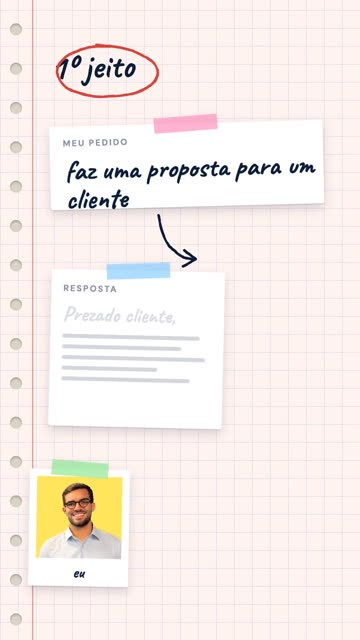

# Caderno desenhado

[Ver o vídeo de exemplo](../previas/caderno.mp4) · composição `Caderno` · código em `src/videos/caderno/CadernoProposta.tsx` · kit em `src/_shared/caderno.tsx`

## O que define o estilo

- Página quadriculada de caderno. A letra de mão se escreve na hora da fala e o traço de caneta se desenha sozinho.
- Marca-texto em cores alternadas, folhas coladas com fita, anotações em vermelho e o apresentador em uma foto de polaroide.
- Combina com comparações do tipo antes e depois e com explicações de método.

## Peças do kit

`FiltrosCaderno` (uma vez), `Pagina` (por baixo), `Escrita`, `Traco`, `Marca`, `Folha`, `Polaroid` e os desenhos `sublinha`, `roda`, `seta`, `xis`, `certo`, `rabisco`. A fonte de mão é `MAO` (Caveat).

## Cuidados

- Letra de mão cresce rápido: limite cada anotação a uma linha curta.
- Dado inventado na tela leva "exemplo" escrito.

## Peça isto ao Claude

> Abra o molde caderno deste repositório e refaça com o meu roteiro: (cole o texto). Vou gravar a narração no celular. Siga o guia `guias/refazer-com-o-claude.md` e me mostre quadros parados antes de renderizar.
