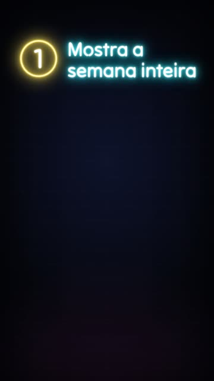

# Desenho que brilha (neon)

[Ver o vídeo de exemplo](../previas/neon.mp4) · composição `Neon` · código em `src/videos/neon/SemanaNeon.tsx` · kit em `src/_shared/neon.tsx`

## O que define o estilo

- Parede escura. Letreiros e desenhos de tubo de neon acendem piscando na palavra certa, com núcleo branco e halo colorido.
- Cada cena apaga piscando antes da próxima.
- Combina com listas curtas, comparações ("colar ou conectar") e frases de impacto.

## Peças do kit

`Parede` (por baixo), `CenaNeon` (uma por cena), `Neon` (texto), `Tubo` (traço), `Bloco`, e caminhos prontos: `circulo`, `moldura`, `setaBaixoN`, `setaDirN`, `certoN`, `xisN`, `sublinhaN`, `pessoaN`, `cartaN`, `relogioN`. `NEON` guarda as cores e `acende` o efeito de piscar.

## Cuidados que já deram problema

- A fonte (Tilt Neon) é larga: uma frase de 25 letras pede tamanho entre 66 e 74, ou quebra em duas linhas.
- Texto muito comprido some no halo. Prefira frases de até seis palavras por letreiro.

## Peça isto ao Claude

> Abra o molde neon deste repositório e refaça com o meu roteiro: (cole o texto). Vou gravar a narração no celular. Siga o guia `guias/refazer-com-o-claude.md` e me mostre quadros parados antes de renderizar.
