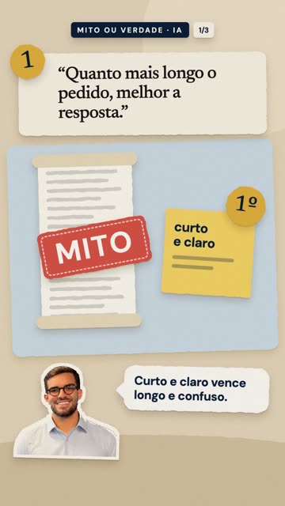

# Papel recortado

[Ver o vídeo de exemplo](../previas/papel-recortado.mp4) · composição `PapelRecortado` · código em `src/videos/papel-recortado/PapelRecortado.tsx` · kit em `src/_shared/papel.tsx`

## O que define o estilo

- Vertical, 20 a 45 segundos, uma frase por cena e corte seco entre cenas.
- Fundo kraft com uma folha colorida inclinada atrás do mundo da cena.
- Tudo é pedaço de papel: borda irregular só no fundo da peça (nunca no texto), sombra dupla, grão por cima de tudo, entrada de 2 em 2 quadros e tremida a cada 4, que lembra stop motion.
- Um mundo novo por frase: dois ou três objetos de papel encenam a ideia e mudam na palavra certa.
- Carimbo batendo na palavra do veredito. O apresentador é um adesivo de borda branca que balança com a voz.

## Como inventar o mundo de uma frase

1. Ache o substantivo concreto da frase (pedido, dado, código, contrato, agenda) e transforme em objeto de escritório: folha, bilhete, pasta, prancheta, envelope, calendário, carimbo, lupa, régua, medalha.
2. Dê ao objeto uma ação que mostra a ideia: crescer, encolher, ganhar disfarce, ser riscado, voar, virar outra coisa.
3. Prenda cada ação a uma palavra da narração com `q('palavra')`.
4. Desenhe só com `div` de cantos arredondados e SVG simples. Sem imagem de banco, sem emoji como ilustração.

## Peças do kit

`Filtros` (uma vez no topo), `Grao` (por último), `Fundo`, `Topo`, `Frase`, `Peca`, `Carimbo`, `Fala`, `Boneco`, `linhas`, e os tempos `cai`, `treme`, `passo`. O exemplo usa todas.

## Cuidados que já deram problema

- Carimbo cobrindo o rótulo do cartão, ou ficando atrás de uma peça que entra depois: confira o quadro do carimbo.
- Enfeite caindo fora do objeto (óculos ao lado do número).
- Abertura vazia no primeiro segundo: ponha peças já no quadro 0.
- O apresentador só balança a cabeça com a voz. O kit tem uma opção de boca abrindo (`boca` no `Boneco`), desligada de propósito: o resultado ficou melhor sem.

## Peça isto ao Claude

> Abra o molde papel-recortado deste repositório e refaça com o meu roteiro: (cole o texto). Vou gravar a narração no celular. Siga o guia `guias/refazer-com-o-claude.md` e me mostre quadros parados antes de renderizar.
