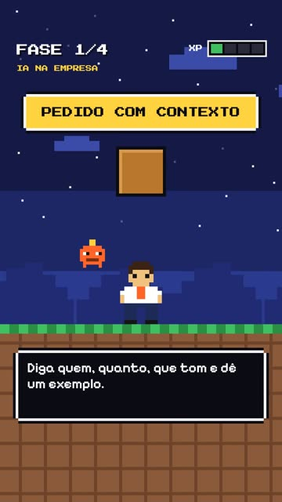

# Pixel art



[Ver o vídeo de exemplo](../previas/pixel-art.mp4) · composição `PixelArt` · código em `src/videos/pixel-art/JogoIa.tsx` · kit em `src/_shared/pixel.tsx`

## O que define o estilo

- Jogo de plataforma 8 bits: céu em faixas com estrelas piscando, chão de blocos, bonecos feitos de quadradinhos.
- Movimento em passos de 2 em 2 quadros, sem suavizar. Isso é o que dá a cara de jogo antigo.
- Caixa de diálogo de RPG com texto digitado, barra de vida e de experiência, fases numeradas e um chefão no fim.
- O exemplo não tem narração: o texto vem escrito na tela, com trilha e efeitos sintetizados.

## Peças do kit

`Sprite` (desenha um boneco a partir de um mapa de texto: cada letra é uma cor da paleta e `.` é vazio), `Ceu`, `Chao`, `CaixaPixel`, `Digita`, `Barra`, `trava` (movimento em passos) e os bonecos prontos `HEROI_A`, `HEROI_B`, `HEROI_PULO`, `ROBO`, `CHEFE`, `ESTRELA`. As fontes são Press Start 2P e Pixelify Sans.

## Som

`ferramentas/som8bit.py` gera a trilha e os efeitos (onda quadrada, triângulo e ruído) com Python e numpy, sem baixar nada:

```bash
pip install numpy
cd public/pixel-art
python3 ../../ferramentas/som8bit.py
```

O script grava `trilha8.wav` e a pasta `sfx/` no lugar onde é executado. Troque a melodia e as notas dentro do script para fazer a sua.

## Ideia de roteiro

Cada fase é um problema do dia a dia, e o jogador o vence com uma boa prática. O chefão é o vício que atrapalha (a pressa, o improviso). Mantenha o texto curto: a caixa de diálogo é pequena.

## Peça isto ao Claude

> Abra o molde pixel-art deste repositório e refaça com o meu roteiro: (cole o texto). Esse estilo não precisa de narração. Siga o guia `guias/refazer-com-o-claude.md` e me mostre quadros parados antes de renderizar.
