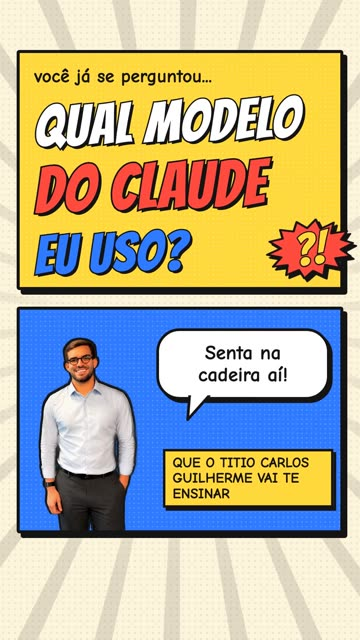

# Quadrinhos

[Ver o vídeo de exemplo](../previas/quadrinhos.mp4) · composição `Quadrinhos` · código em `src/videos/quadrinhos/ModelosGibi.tsx` · kit em `src/_shared/gibi.tsx`

## O que define o estilo

- Página de gibi com retícula. Os painéis têm contorno grosso e sombra dura, e pulam na hora da fala.
- Letreiro com contorno preto, legendas amarelas, balões de fala e estouros de onomatopeia.
- Uma página por assunto, com virada de página entre as cenas. O exemplo dedica uma página a cada modelo de IA.
- Bom para comparar itens lado a lado.

## Peças do kit

`PaginaGibi` (por baixo), `CenaGibi` (uma por cena), `Painel`, `Letreiro`, `Texto`, `Legenda`, `Balao`, `Estouro`, `Raios`, `Haltere`, e o efeito `pula`. As fontes são `LETREIRO` (Bangers) e `FALA` (Comic Neue).

## Cuidados que já deram problema

- Estouro por cima de texto: confira cada página em quadro parado.
- Muita coisa por página cansa. Um painel principal, um balão e, no máximo, um estouro.

## Peça isto ao Claude

> Abra o molde quadrinhos deste repositório e refaça com o meu roteiro: (cole o texto). Vou gravar a narração no celular. Siga o guia `guias/refazer-com-o-claude.md` e me mostre quadros parados antes de renderizar.
