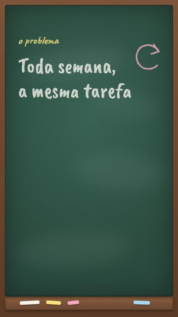

# Quadro-negro

[Ver o vídeo de exemplo](../previas/quadro-negro.mp4) · composição `QuadroNegro` · código em `src/videos/quadro-negro/SkillQuadro.tsx` · kit em `src/_shared/quadro.tsx`

## O que define o estilo

- Lousa verde com moldura de madeira. Texto e desenhos são escritos a giz no instante em que a palavra é dita.
- O traço treme de leve: três variações do filtro, trocando a cada 4 quadros.
- Cada cena termina com um apagador passando antes da próxima.
- Fica bom em explicação passo a passo, "como fazer" e listas.

## Peças do kit

`Quadro` (por baixo), `FiltrosQuadro` (uma vez), `CenaQuadro` (uma por cena, com início e fim), `Giz` (texto), `Risco` (traço), e caminhos prontos: `caixa`, `oval`, `setaDir`, `setaBaixo`, `setaCima`, `sublinha`, `certo`, `laco`, `notebook`, `pasta`.

## Cuidados que já deram problema

- A última frase de cada cena precisa terminar antes do apagador começar (cerca de 8 quadros antes do fim da cena). Se terminar depois, o apagador corta a palavra.
- Giz de uma cor só cansa: varie as cores do giz para separar ideias.

## Peça isto ao Claude

> Abra o molde quadro-negro deste repositório e refaça com o meu roteiro: (cole o texto). Vou gravar a narração no celular. Siga o guia `guias/refazer-com-o-claude.md` e me mostre quadros parados antes de renderizar.
